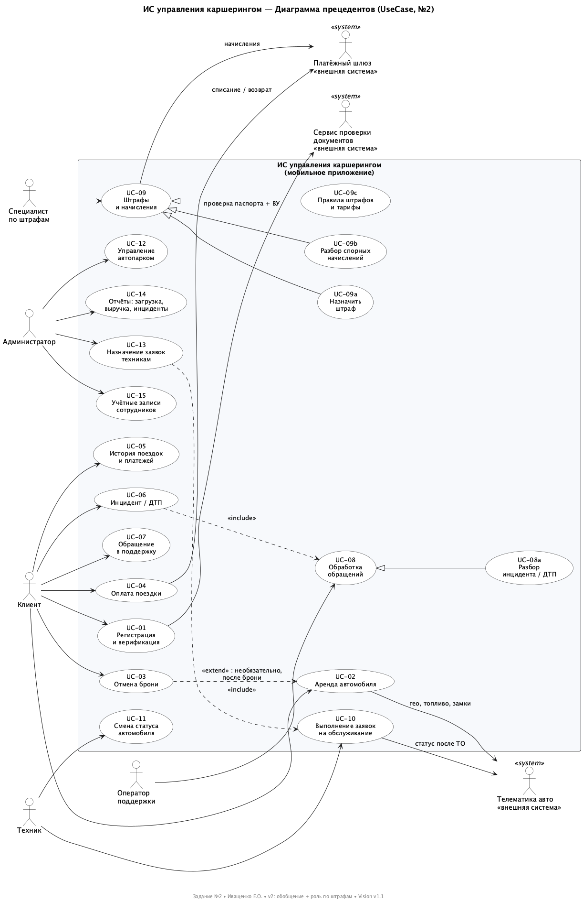

# Задание №2 — Диаграмма прецедентов (UseCase Diagram)

| | |
|---|---|
| **Проект** | Информационная система управления сервисом каршеринга |
| **Задание** | №2 UseCase Diagram. Составить диаграмму прецедентов |
| **Цель шага** | Основные действующие лица и их цели (без детализации бизнес-контекста и поведения системы) |
| **Ответственный** | Иващенко Е. О. (ПИ-б-о-241, технический лидер, архитектор) |
| **Помогали** | Бобренко А. И., Щербова А. А. |
| **Ревьюер** | Гуржуев В. А. |
| **Версия** | 2 (компактная, с обобщением и отдельной ролью по штрафам) |
| **Источник** | `docs/01-vision-and-scope.md` v1.1 |
| **Файлы** | `usecase.puml` — исходник (PlantUML), `usecase.png` — экспорт |

---

## 1. Что изменилось в версии 2

| Изменение | Зачем |
|---|---|
| Добавлена роль **«Специалист по штрафам»**, отдельно от администратора | Штрафы, начисления, споры и правила тарифов — отдельная зона ответственности, а не размазанная между админом и поддержкой |
| Прецеденты сгруппированы через **обобщение** (generalization) | Убирает дублирование и визуальный шум: актор связан с общим прецедентом, частные — его виды |
| **«Отмена брони»** — отдельный прецедент-`extend` | Это необязательная возможность клиента после бронирования, а не часть основного сценария |
| Из названий прецедентов убрано **«15 минут»** | Время — это бизнес-правило (задание №4), а не цель актора. На UseCase-уровне ему не место |
| Сокращено число эллипсов (22 → 19) и убраны лишние связи актор→частный UC | Диаграмма читается, слева больше не «стена» из кейсов |

> Как пересобрать: `java -jar plantuml.jar -tpng usecase.puml` (нужны Java + Graphviz `dot`).

---

## 2. Граница системы

**ИС управления каршерингом (мобильное приложение).**

Внутри — только то, что реализует система. Снаружи — люди-акторы и внешние системы. Веб-кабинета нет: сотрудники работают в том же приложении, интерфейс зависит от роли (Vision §3).

---

## 3. Акторы

| Актор | Тип | Цель |
|---|---|---|
| **Клиент** | человек, основной | Найти авто, забронировать, начать/завершить аренду, оплатить, получить помощь |
| **Оператор поддержки** | человек, сотрудник | Обрабатывать обращения, разбирать инциденты и ДТП |
| **Специалист по штрафам** | человек, сотрудник | Назначать штрафы и доплаты, разбирать споры, вести правила штрафов и тарифы |
| **Техник** | человек, сотрудник | Выполнять заявки на обслуживание, менять статус авто |
| **Администратор** | человек, сотрудник | Управлять парком, назначать заявки, смотреть отчёты, вести учётки |
| **Сервис проверки документов** `<<внешняя система>>` | система | Проверка паспорта и ВУ |
| **Платёжный шлюз** `<<внешняя система>>` | система | Списание и возврат денег, начисления |
| **Телематика авто** `<<внешняя система>>` | система | Гео, топливо, замки, статус |

> Роль «Специалист по штрафам» введена по решению команды: в Vision её функции частично лежали на администраторе (правила) и операторе (споры), но по факту это отдельный процесс с своими правилами и доказательствами. В задании №4 её надо отразить в бизнес-правилах.

---

## 4. Прецеденты

### Клиент

| ID | Прецедент | Цель |
|---|---|---|
| UC-01 | Регистрация и верификация | Создать аккаунт, пройти проверку паспорта и ВУ |
| UC-02 | Аренда автомобиля | Найти авто, забронировать, открыть, доехать, закрыть. **Общий** прецедент |
| UC-03 | Отмена брони | **Необязательный** (`extend` UC-02): освободить авто после брони |
| UC-04 | Оплата поездки | Привязать карту и оплатить поездку |
| UC-05 | История поездок и платежей | Посмотреть поездки, чеки, списания |
| UC-06 | Инцидент / ДТП | Зафиксировать инцидент с фото и описанием |
| UC-07 | Обращение в поддержку | Написать в поддержку, оспорить начисление |

### Оператор поддержки

| ID | Прецедент | Цель |
|---|---|---|
| UC-08 | Обработка обращений | Принять, классифицировать, ответить, закрыть обращение |
| UC-08a | Разбор инцидента / ДТП | **Вид** UC-08 (обобщение): определить вину, собрать документы |

### Специалист по штрафам

| ID | Прецедент | Цель |
|---|---|---|
| UC-09 | Штрафы и начисления | Общий прецедент: работа с штрафами и доплатами |
| UC-09a | Назначить штраф | **Вид** UC-09: выставить штраф по основанию |
| UC-09b | Разбор спорных начислений | **Вид** UC-09: проверить основание и доказательства, подтвердить/отменить |
| UC-09c | Правила штрафов и тарифы | **Вид** UC-09: вести размеры штрафов и тарифы |

### Техник

| ID | Прецедент | Цель |
|---|---|---|
| UC-10 | Выполнение заявок на обслуживание | Взять заявку, выполнить работы, отчитаться |
| UC-11 | Смена статуса автомобиля | Свободен / в аренде / на обслуживании / недоступен |

### Администратор

| ID | Прецедент | Цель |
|---|---|---|
| UC-12 | Управление автопарком | Добавлять и вести автомобили |
| UC-13 | Назначение заявок техникам | Создать заявку, назначить техника, контролировать |
| UC-14 | Отчёты: загрузка, выручка, инциденты | Получить базовые отчёты |
| UC-15 | Учётные записи сотрудников | Создавать и блокировать учётки |

---

## 5. Обобщение, include и extend

### Обобщение (generalization) — главный приём компактности

Актор связан только с **общим** прецедентом. Частные — его виды (стрелка с полым треугольником).

| Общий | Виды | Почему |
|---|---|---|
| UC-08 Обработка обращений | UC-08a Разбор инцидента / ДТП | ДТП — частный, более сложный случай обращения |
| UC-09 Штрафы и начисления | UC-09a Назначить штраф, UC-09b Разбор спора, UC-09c Правила | Всё это разные виды работы со штрафами, общий актор — специалист |

Благодаря этому «Специалист по штрафам» имеет **одну** связь на диаграмме, а не четыре.

### include / extend

| Связь | Тип | Обоснование |
|---|---|---|
| UC-03 `..>` UC-02 | `<<extend>>` | Отмена брони — **необязательная** возможность клиента после бронирования, не основной поток |
| UC-06 `..>` UC-08 | `<<include>>` | Фиксация инцидента всегда создаёт обращение в поддержку |
| UC-13 `..>` UC-10 | `<<include>>` | Назначение заявки включает её выполнение техником |

---

## 6. Внешние системы

| Прецедент | Система | Что запрашиваем |
|---|---|---|
| UC-01 | Сервис проверки документов | Паспорт + ВУ |
| UC-02 | Телематика | Гео, топливо, открыть/закрыть замки |
| UC-04 | Платёжный шлюз | Списание / возврат |
| UC-09 | Платёжный шлюз | Начисления по штрафам |
| UC-10 | Телематика | Статус после ТО |

---

## 7. Где «15 минут» и тарифы

Сознательно **не** в названиях прецедентов:

- «15 минут бесплатно, далее 4 ₽/мин» — бизнес-правило бронирования → задание №4.
- «8 / 4 / 1500 ₽» — тарифы → задание №4, UC-09c.
- Суммы штрафов и франшиза ДТП → задание №4, UC-09a/UC-09b.

UseCase отвечает на «кто и зачем», а не «сколько и когда». Иначе диаграмма превращается в спецификацию требований.

---

## 8. Трассировка к Vision & Scope

| In Scope | Покрывается |
|---|---|
| Регистрация и верификация | UC-01 |
| Карта, поиск, бронирование | UC-02, UC-03 |
| Начало / завершение аренды, зона | UC-02 |
| Тарифы и расчёт | UC-02, UC-09c |
| Оплата, история | UC-04, UC-05 |
| Штрафы и доплаты | UC-09, UC-09a, UC-09b |
| Инциденты и ДТП | UC-06, UC-08a |
| Обращения и споры | UC-07, UC-08, UC-09b |
| Парк и статусы | UC-12, UC-11 |
| Заявки на обслуживание | UC-13, UC-10 |
| Отчёты | UC-14 |
| Учётки сотрудников | UC-15 |

Out of Scope (сайт, ГИБДД, страховые, лояльность, динамические цены, юрлица, межгород, распознавание повреждений, железо телематики, бухгалтерия) — отсутствует сознательно.

---

## 9. Принятые решения

1. Одна граница системы — верхнеуровневый срез, без подсистем.
2. Роль «Специалист по штрафам» выделена из администратора и поддержки.
3. Компактность достигнута обобщением, а не удалением целей: каждая цель осталась, но сгруппирована.
4. «Отмена брони» — отдельный `extend`, потому что это опция, а не обязательный шаг.
5. Время и деньги — в бизнес-правилах (№4), не в прецедентах.
6. Формат — PlantUML (исходник + PNG), по зоне ответственности Иващенко.

---

## 10. Файлы папки

- `usecase.puml` — исходник диаграммы
- `usecase.png` — экспорт
- `README.md` — этот документ
