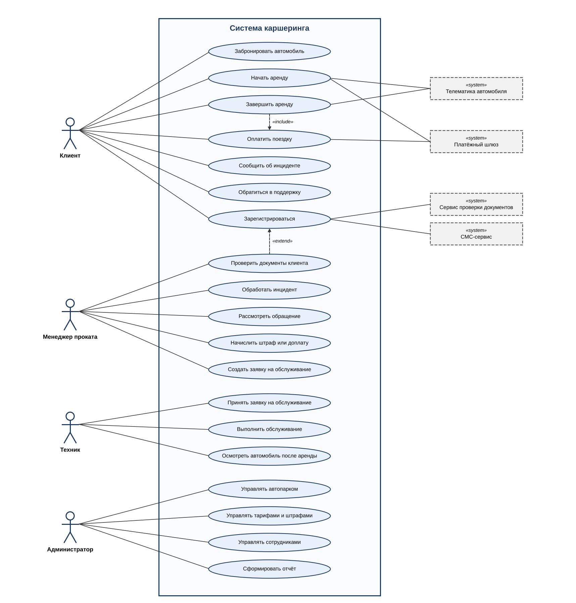

# Задание 2. Диаграмма прецедентов (Use Case Diagram)

Контекст проекта, тип проекта и методы выявления требований описаны в [Vision & Scope](../01-vision-and-scope.md) (разделы 2 и приложение В). Здесь приведены только акторы, стейкхолдеры и сама диаграмма.

## 1. Стейкхолдеры и акторы

**Стейкхолдеры** (кому важна система, но кто может не работать с ней напрямую): руководство Прокатной компании, бухгалтерия, юрист, страховая компания, ГИБДД, регулятор по персональным данным. Подробно: Vision & Scope, раздел 2.

**Акторы** (кто работает с системой напрямую):

| Актор | Тип | Основная цель |
|---|---|---|
| Клиент | Человек | Взять автомобиль на короткое время без визита в офис |
| Менеджер проката | Человек | Разбирать сложные случаи дистанционно: документы, инциденты, обращения, начисления |
| Техник | Человек | Обслуживать автомобили и подтверждать их состояние |
| Администратор | Человек | Управлять парком, тарифами, сотрудниками, получать отчёты |
| Сервис проверки документов | Внешняя система | Проверять паспорт и водительское удостоверение |
| СМС-сервис | Внешняя система | Отправлять коды подтверждения |
| Платёжный шлюз | Внешняя система | Блокировать суммы и списывать оплату |
| Телематика автомобиля | Внешняя система | Открывать и закрывать автомобиль, передавать топливо и геопозицию |

## 2. Диаграмма

Файлы: [PNG](usecase-diagram.png), [SVG](usecase-diagram.svg) (редактируется в draw.io и Inkscape), исходник рисовальщика: [src/gen_usecase.py](src/gen_usecase.py).

## 3. Перечень прецедентов

| ID | Прецедент | Актор | Внешние системы | Цель |
|---|---|---|---|---|
| UC-01 | Зарегистрироваться | Клиент | Сервис проверки документов, СМС-сервис | Получить доступ к аренде без визита в офис |
| UC-02 | Проверить документы клиента | Менеджер проката | — | Принять решение по документам, если автоматическая проверка неоднозначна |
| UC-03 | Забронировать автомобиль | Клиент | — | Закрепить свободный автомобиль за собой на 15 минут |
| UC-04 | Начать аренду | Клиент | Телематика, Платёжный шлюз | Осмотреть автомобиль, внести обеспечительную сумму и открыть автомобиль |
| UC-05 | Завершить аренду | Клиент | Телематика | Закрыть аренду в зоне обслуживания |
| UC-06 | Оплатить поездку | (включается в UC-05) | Платёжный шлюз | Оплатить стоимость аренды и доплаты |
| UC-07 | Сообщить об инциденте | Клиент | — | Зафиксировать ДТП или повреждение и получить помощь |
| UC-08 | Обратиться в поддержку | Клиент | — | Задать вопрос или оспорить начисление |
| UC-09 | Обработать инцидент | Менеджер проката | — | Определить вину и долю клиента |
| UC-10 | Рассмотреть обращение | Менеджер проката | — | Ответить клиенту, подтвердить или отменить начисление |
| UC-11 | Начислить штраф или доплату | Менеджер проката | — | Зафиксировать обоснованное начисление с доказательствами |
| UC-12 | Создать заявку на обслуживание | Менеджер проката | — | Отправить автомобиль на мойку, заправку, ТО или ремонт |
| UC-13 | Принять заявку на обслуживание | Техник | — | Взять заявку в работу |
| UC-14 | Выполнить обслуживание | Техник | — | Обслужить автомобиль и вернуть его в парк |
| UC-15 | Осмотреть автомобиль после аренды | Техник | — | Подтвердить загрязнение или повреждения |
| UC-16 | Управлять автопарком | Администратор | — | Добавлять, списывать автомобили, менять статусы |
| UC-17 | Управлять тарифами и штрафами | Администратор | — | Задавать размеры тарифов и штрафов |
| UC-18 | Управлять сотрудниками | Администратор | — | Создавать учётные записи сотрудников и назначать роли |
| UC-19 | Сформировать отчёт | Администратор | — | Получить данные по загрузке, выручке и инцидентам |

## 4. Решения по моделированию

- **Название прецедента = глагол + объект.** Прецеденты описывают цели, а не шаги и не кнопки.
- **Не более 5-7 прецедентов на актора.** У клиента 7 (включая «Оплатить поездку», которая подключается через `include`), у менеджера 5, у техника 3, у администратора 4.
- **`include`:** «Завершить аренду» всегда включает «Оплатить поездку», потому что аренда не закрывается без расчёта.
- **`extend`:** «Проверить документы клиента» расширяет «Зарегистрироваться» и выполняется только если автоматическая проверка не дала однозначного результата. Именно этот прецедент заменяет очную проверку документов менеджером в офисе.
- Других `include` и `extend` нет: лекция советует не использовать их, если нет уверенности.
- Внешние системы показаны справа как прямоугольники со стереотипом «system», люди слева как стикмены.
- Диаграмма не показывает порядок действий. Он описан в [диаграммах деятельности](../03-activity-diagrams/activity-diagrams.md).
- Роль «Руководитель» не выделена: её функции выполняет администратор.
