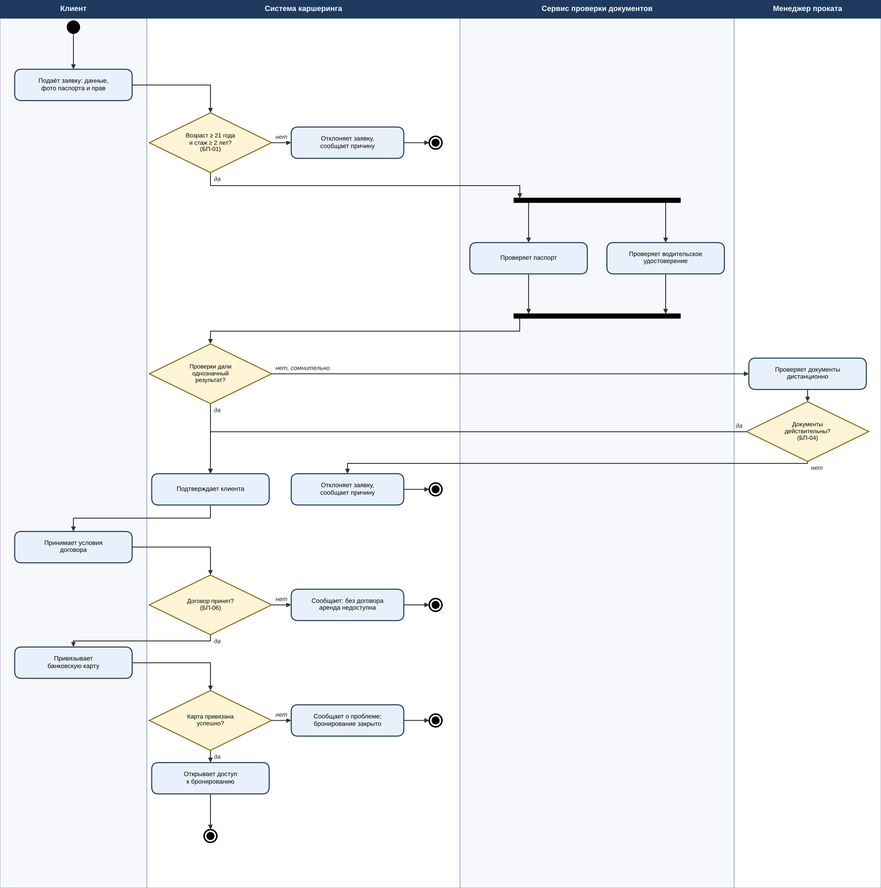
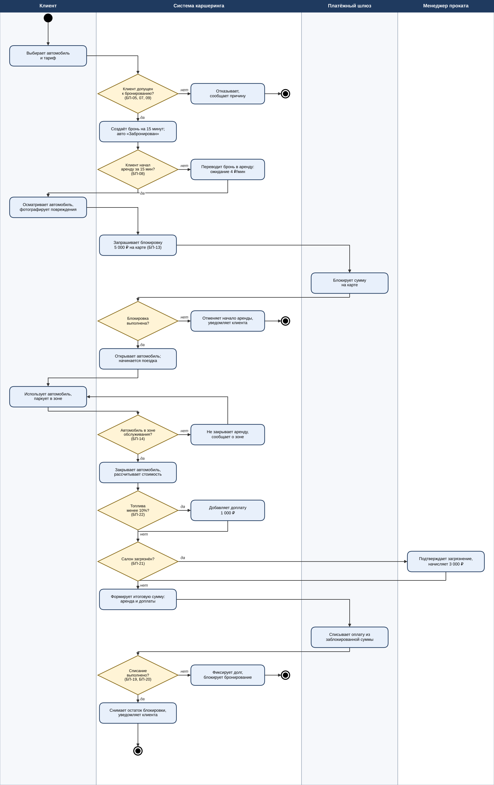
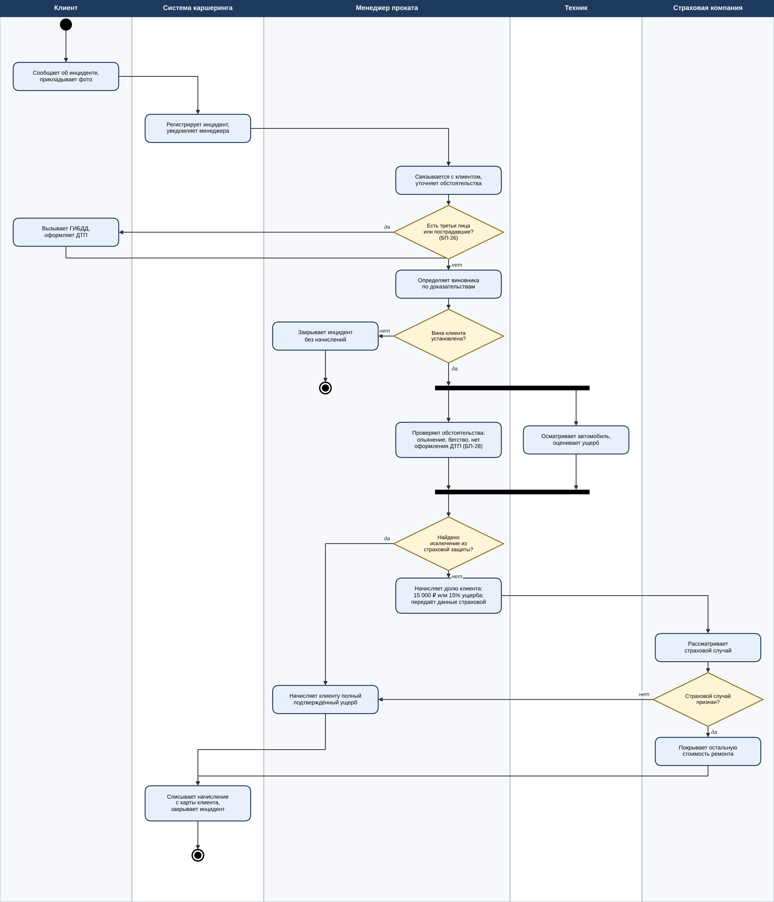

# Задание 3. Диаграммы деятельности (Activity Diagram)

Для моделирования выбраны три сложных прецедента: в каждом больше трёх ветвлений, есть альтернативные потоки, смена статусов и внешние роли (лекция 2: для такого процесса диаграмма обязательна). Простые линейные прецеденты (например, «Забронировать автомобиль», «Управлять сотрудниками») не моделируются: для них достаточно текста в [спецификации](../05-requirements/user-stories.md).

| № | Прецедент | Почему сложный | Что заменяет в классическом прокате |
|---|---|---|---|
| 1 | [UC-01 Зарегистрироваться и пройти верификацию](#1-регистрация-и-дистанционная-верификация) | 4 ветвления, параллельные проверки, три роли и внешний сервис | Очная проверка документов менеджером, бумажный договор |
| 2 | [UC-03, UC-04, UC-05, UC-06 Аренда от брони до оплаты](#2-аренда-от-брони-до-оплаты) | 8 ветвлений, возврат в цикл, блокировка суммы, начисления | Выдача ключей и акт приёма-передачи в офисе, залог, возврат с осмотром менеджером |
| 3 | [UC-07, UC-09 Инцидент и ДТП по вине клиента](#3-инцидент-и-дтп-по-вине-клиента) | 6 ветвлений, 5 ролей, параллельные работы, страховая | Оформление ДТП и расчёты по ущербу «на бумаге» |

**Правила моделирования (лекция 2).** На дорожках только бизнес-роли и внешние организации или системы, без «фронтенда» и «базы данных». В ромбах только бизнес-правила (идентификаторы БП-xx ссылаются на [бизнес-правила](../04-domain/business-rules.md)), без технической валидации полей. Состояния объектов называются так же, как в [диаграммах состояний](../07-state-diagrams/state-diagrams.md).

Файлы: у каждой диаграммы есть PNG и SVG (SVG открывается в draw.io и Inkscape), исходники лежат в [src/](src/).

---

## 1. Регистрация и дистанционная верификация



[PNG](ad-1-registration.png) · [SVG](ad-1-registration.svg)

**Роли:** Клиент, Система каршеринга, Сервис проверки документов, Менеджер проката.

**Что показывает диаграмма.** В классическом прокате вся эта цепочка происходит в офисе: менеджер смотрит паспорт и права, клиент подписывает договор ручкой. Здесь клиент загружает документы в приложении, система проверяет допуск по возрасту и стажу и параллельно (fork/join) отправляет паспорт и права на проверку. Менеджер подключается только если результат неоднозначен и проверяет документы дистанционно.

**Выявленные правила и ограничения:**

- БП-01: возраст не менее 21 года и стаж не менее 2 лет, иначе заявка отклоняется сразу, до проверки документов.
- БП-04: неоднозначный результат проверки решает менеджер, а не автоматика.
- БП-06: без принятого договора аренда недоступна.
- Бронирование открывается только после успешной привязки банковской карты.

**Что нашли при моделировании (логические дыры):**

- У каждой ветки отказа должна быть причина, которую видит клиент (иначе клиент не поймёт, что исправлять). Это попало в спецификацию как отдельное требование.
- После отказа по документам клиент может подать исправленный комплект (см. диаграмму состояний «Клиент»), поэтому отказ не финальное состояние.

---

## 2. Аренда от брони до оплаты



[PNG](ad-2-rental.png) · [SVG](ad-2-rental.svg)

**Роли:** Клиент, Система каршеринга, Платёжный шлюз, Менеджер проката.

**Что показывает диаграмма.** Полный жизненный путь аренды: допуск, бронь на 15 минут, осмотр и блокировка обеспечительной суммы, открытие автомобиля, поездка, проверка зоны, расчёт стоимости, доплаты, списание. Фотоосмотр клиента заменяет бумажный акт приёма-передачи, блокировка суммы заменяет залог, закрытие в приложении заменяет возврат ключей менеджеру.

**Выявленные правила и ограничения:**

- БП-05, БП-07, БП-09: бронировать может только подтверждённый клиент, без долга и без другой активной брони или аренды.
- БП-08: если за 15 минут аренда не начата, бронь автоматически переходит в аренду в режиме ожидания (4 ₽/мин).
- БП-13: при начале аренды блокируется 5 000 ₽; без блокировки аренда не начинается.
- БП-14: завершить аренду можно только в зоне обслуживания. Вне зоны система аренду не закрывает, клиент возвращается в цикл «Использует автомобиль».
- БП-22: топливо менее 10% приводит к доплате 1 000 ₽.
- БП-21: загрязнённый салон приводит к начислению 3 000 ₽, но только после подтверждения менеджером по фотоотчёту.
- БП-19, БП-20: оплата списывается из заблокированной суммы, при неудаче фиксируется долг и блокируется бронирование.

**Что нашли при моделировании (логические дыры):**

- Нужно решить, что происходит, если итоговая сумма больше заблокированных 5 000 ₽: разница списывается с карты (учтено в БП-13).
- Нужен выход из цикла «вне зоны» для случая, когда клиент оставил автомобиль и не может вернуться: менеджер закрывает аренду и начисляет штраф (БП-14, переход в диаграмме состояний аренды).
- Начисление за загрязнение нельзя делать автоматически: без подтверждения менеджера оно не защищено от спора (БП-24).

---

## 3. Инцидент и ДТП по вине клиента



[PNG](ad-3-incident.png) · [SVG](ad-3-incident.svg)

**Роли:** Клиент, Система каршеринга, Менеджер проката, Техник, Страховая компания.

**Что показывает диаграмма.** Процесс от сообщения клиента до закрытия инцидента и расчёта долей. Параллельно (fork/join) техник оценивает ущерб, а менеджер проверяет обстоятельства на исключения из страховой защиты. Дальше путь делится: при исключении клиент платит весь подтверждённый ущерб, иначе клиент платит только свою долю, а остальное покрывает страховая.

**Выявленные правила и ограничения:**

- БП-26: клиент обязан сообщить об инциденте сразу, при третьих лицах или пострадавших обязан вызвать ГИБДД.
- БП-27: доля клиента 15 000 ₽ при ущербе до 100 000 ₽, иначе 15% ущерба; остальное покрывает страховая.
- БП-28: при исключении (опьянение, бегство с места ДТП, не оформил ДТП, передал руль, грубое нарушение договора) или отказе страховой клиент платит полный подтверждённый ущерб.
- БП-24: любое начисление требует основания и доказательств.

**Что нашли при моделировании (логические дыры):**

- Если страховая отказала уже после начисления доли, нужно доначислить клиенту остаток. Поэтому на диаграмме от «Страховой случай признан? нет» есть переход к полному ущербу.
- Кто закрывает инцидент без вины клиента и что происходит с блокировкой суммы: вина не установлена, начислений нет, блокировка снимается при завершении аренды.

---

## Как перерисовать диаграммы

Диаграммы описаны кодом на Python (matplotlib) в папке [src/](src/). Чтобы изменить диаграмму, правьте узлы и связи в соответствующем файле и запустите:

```bash
cd docs/03-activity-diagrams/src
pip install matplotlib
python3 ad_registration.py   # ad-1-registration.png / .svg
python3 ad_rental.py         # ad-2-rental.png / .svg
python3 ad_incident.py       # ad-3-incident.png / .svg
```

Файлы появятся в папке `src/`, их нужно переместить на уровень выше. Если проще, откройте SVG в [draw.io](https://app.diagrams.net) и правьте вручную.
