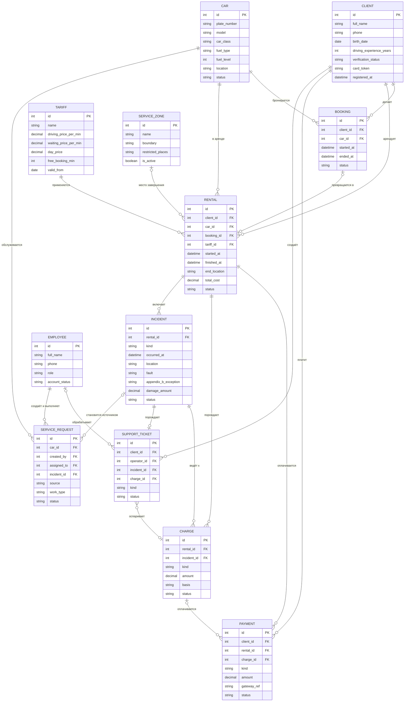

# Сущности предметной области

| | |
|---|---|
| **Проект** | Информационная система управления сервисом каршеринга (Симферополь, мобильное приложение) |
| **Задание** | №4. Термины, бизнес-правила и сущности |
| **Ответственный** | Диденко А. Е. |
| **Помогали** | Щербова А. А., Бобренко А. И. |
| **Ревьюер** | Иващенко Е. О. |
| **Источники** | `docs/01-vision-and-scope.md` v1.1, `docs/03-activity-diagrams/` (AD-01…AD-03), сводка R-01…R-11 из задания №3 |
| **Связанные файлы** | [glossary.md](glossary.md), [business-rules.md](business-rules.md) |

Сущность — это объект предметной области, о котором система хранит данные. У каждой сущности есть идентификатор (`id`). Атрибуты логические, это не схема базы данных. Сущностей 12; «Доказательство» (фото, акты) не вынесено отдельно, а хранится как вложения у «Инцидента» и «Штрафа/Доплаты» (R-06 из задания №3).

## Сводная таблица

| № | Сущность | Назначение | Ключевые атрибуты | Статусы |
|---|---|---|---|---|
| 1 | **Клиент** | Человек, который бронирует и арендует автомобили | `id`, ФИО, телефон, дата рождения, водительский стаж (лет), статус верификации, токен карты платёжного шлюза, дата регистрации | Верификация: не пройдена, на проверке, подтверждена, отклонена |
| 2 | **Сотрудник** | Пользователь с ролью «Оператор поддержки», «Техник» или «Администратор» | `id`, ФИО, телефон, роль, статус учётной записи | Учётная запись: активна, заблокирована |
| 3 | **Автомобиль** | Машина автопарка | `id`, госномер, марка и модель, класс, тип топлива, уровень топлива, геопозиция, статус | **Свободен, в аренде, на обслуживании, недоступен** (как в Vision §4) |
| 4 | **Зона обслуживания** | Разрешённая территория завершения аренды | `id`, название, границы зоны, запрещённые места, признак «действует» | Действует, не действует |
| 5 | **Тариф** | Набор цен для расчёта стоимости | `id`, название, цена минуты движения (8 ₽), цена минуты ожидания (4 ₽), цена суток (1 500 ₽), бесплатная бронь (15 мин), действует с | Действует, архивный |
| 6 | **Бронь** | Закрепление свободного автомобиля за клиентом | `id`, клиент, автомобиль, время начала, время окончания, статус | Активна, превращена в аренду, отменена, снята |
| 7 | **Аренда** | Период пользования автомобилем | `id`, клиент, автомобиль, бронь (необязательно), тариф, время начала, время окончания, гео завершения, стоимость, статус | Активна, завершена |
| 8 | **Платёж** | Операция списания или возврата через платёжный шлюз | `id`, клиент, аренда или начисление, вид, сумма, ссылка шлюза, дата, статус | Ожидает, успешен, отклонён (задолженность), возврат |
| 9 | **Штраф/Доплата** | Начисление клиенту за нарушение или ДТП | `id`, аренда, инцидент (необязательно), вид, сумма, основание, вложения (доказательства), статус | Создано, подтверждено, оспорено, отменено или скорректировано |
| 10 | **Инцидент (ДТП)** | Зафиксированное происшествие во время аренды | `id`, аренда, вид (ДТП или иной), время, геопозиция, описание, вложения (фото, акты), вина, исключение из прил. Б, ущерб | Зафиксирован, в разборе, закрыт без начисления, начисление создано |
| 11 | **Заявка на обслуживание** | Задание технику на мойку, заправку, ТО или ремонт | `id`, автомобиль, создатель (администратор), исполнитель (техник), источник, вид работ, срок, результат | Создана, назначена, в работе, на приёмке, закрыта, эскалирована |
| 12 | **Обращение в поддержку** | Вопрос, проблема или спор клиента | `id`, клиент, оператор, вид (вопрос, инцидент, спор), связанный инцидент или начисление, текст, дата создания, дата закрытия | Открыто, в работе, закрыто |

## Связи

- Клиент 1 — * Бронь. Один клиент за всё время делает много броней, но активна одна (БП-03).
- Автомобиль 1 — * Бронь.
- Бронь 0..1 — 0..1 Аренда. Бронь превращается в аренду не более одного раза; аренда может начаться и без брони (AD-01).
- Клиент 1 — * Аренда. Активна одновременно одна (БП-03).
- Автомобиль 1 — * Аренда. Одновременно у автомобиля одна активная аренда.
- Тариф 1 — * Аренда. К аренде применяется один тариф.
- Зона обслуживания 0..1 — * Аренда. Зона, в которой завершена аренда; пусто, если аренда ещё идёт или завершена вне зоны.
- Аренда 1 — * Платёж. Основной платёж за поездку и повторные попытки.
- Аренда 1 — * Штраф/Доплата. У аренды может быть несколько начислений.
- Аренда 1 — * Инцидент. Инцидент всегда привязан к аренде (БП-11).
- Инцидент 1 — * Штраф/Доплата. Начислений по инциденту может быть несколько или не быть вообще (вины нет).
- Штраф/Доплата 0..1 — * Платёж. Начисление оплачивается одним платежом или несколькими попытками.
- Клиент 1 — * Платёж.
- Клиент 1 — * Обращение в поддержку.
- Сотрудник (оператор) 0..1 — * Обращение в поддержку. Оператор обрабатывает много обращений.
- Инцидент 1 — 0..1 Обращение. При фиксации инцидента система создаёт обращение (UC-11).
- Обращение * — 0..1 Штраф/Доплата. Спор по начислению (UC-10).
- Автомобиль 1 — * Заявка на обслуживание.
- Сотрудник (администратор, техник) 1 — * Заявка. Один создаёт, другой выполняет.
- Инцидент 0..1 — * Заявка на обслуживание. Один из источников заявки (AD-03).

## ER-диаграмма

Английские идентификаторы нужны только для отрисовки; соответствие русским названиям см. в таблице ниже диаграммы.

| Идентификатор | Сущность |
|---|---|
| CLIENT | Клиент |
| EMPLOYEE | Сотрудник |
| CAR | Автомобиль |
| SERVICE_ZONE | Зона обслуживания |
| TARIFF | Тариф |
| BOOKING | Бронь |
| RENTAL | Аренда |
| PAYMENT | Платёж |
| CHARGE | Штраф/Доплата |
| INCIDENT | Инцидент (ДТП) |
| SERVICE_REQUEST | Заявка на обслуживание |
| SUPPORT_TICKET | Обращение в поддержку |

## Проверка по чек-листу задания

- У каждой сущности есть `id` и содержательные атрибуты.
- Статусы автомобиля совпадают с Vision §4: свободен, в аренде, на обслуживании, недоступен.
- Лишних сущностей нет: «Промокод», «Юридическое лицо», «Программа лояльности» и «Страховой случай» в Vision в разделе «Не входит». Банковская карта не хранится: у клиента только токен шлюза (Vision §5).
- Цепочка логична: бронь превращается в аренду, у аренды могут быть штраф и инцидент, инцидент ведёт к начислению и обращению.
- Сущность «Начисление» из заметок AD-02 здесь называется «Штраф/Доплата» (по заданию).
