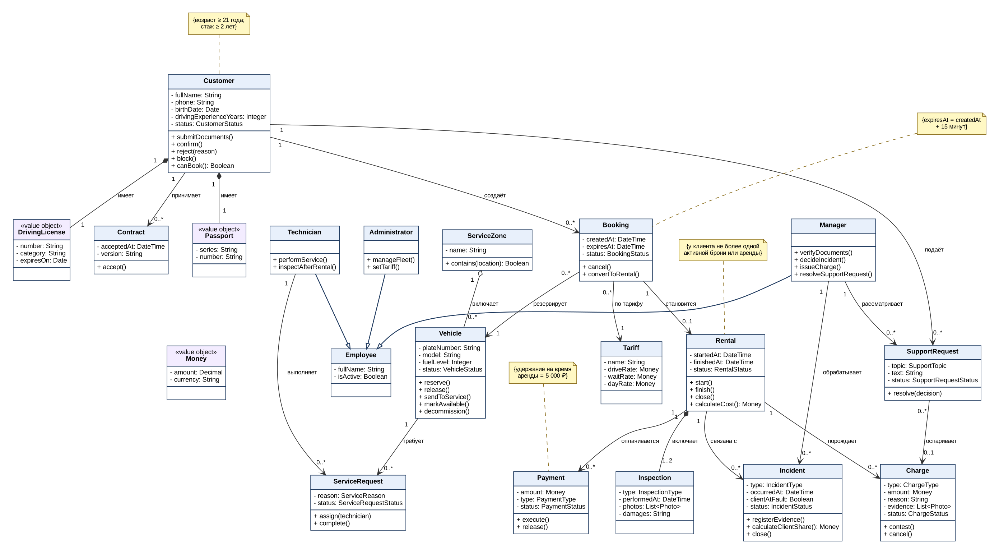

# Задание 6. Диаграмма классов доменной модели

Концептуальная модель предметной области без технической детализации (без таблиц, внешних ключей и сервисных классов). Диаграмма выросла из трёх источников: сущности из [описания сущностей](../04-domain/entities.md), статусы из [диаграмм состояний](../07-state-diagrams/state-diagrams.md), ограничения из [критериев приёмки](../05-requirements/user-stories.md) и [бизнес-правил](../04-domain/business-rules.md).



Файлы: [PNG](class-diagram.png), [SVG](class-diagram.svg), исходник Graphviz [src/class-diagram.dot](src/class-diagram.dot), генератор [src/gen_classes.py](src/gen_classes.py).

## Обозначения

| Элемент | Смысл |
|---|---|
| Сплошная линия с открытой стрелкой | Ассоциация («знает о», «использует»), с именем связи и кратностью |
| Линия с закрашенным ромбом у «целого» | Композиция: часть не существует без целого (клиент и его паспорт, аренда и её осмотры) |
| Линия с пустым ромбом у «целого» | Агрегация: часть существует независимо (автомобиль и зона обслуживания) |
| Линия с пустым треугольником у родителя | Обобщение («является»): менеджер, техник и администратор являются сотрудниками |
| Жёлтые заметки с фигурными скобками | Ограничения значений из бизнес-правил |
| «value object» | Объект-значение: у него нет собственной жизни, только структура и правила (Money, Passport, DrivingLicense) |

Знак `-` у атрибута означает закрытый атрибут, `+` у метода открытую операцию. Имена классов в единственном числе, существительные, на английском, как в лекции 4. Русские названия и определения: [глоссарий](../04-domain/glossary.md).

## Проектные решения

- **Статусы вынесены в отдельные типы** (`status: BookingStatus`, а не `String`). Допустимые значения и переходы показаны в [диаграммах состояний](../07-state-diagrams/state-diagrams.md).
- **Деньги всегда `Money`** (сумма и валюта), а не число: все тарифы, платежи и начисления используют один класс.
- **`Payment` и `Charge` разделены.** `Charge` это основание для денежного требования (доплата или штраф с доказательствами), `Payment` фактическое движение денег (блокировка, списание, возврат). Один `Charge` может быть закрыт одним или несколькими `Payment`.
- **Обобщение `Employee` ← `Manager`, `Technician`, `Administrator`** выбрано, потому что у ролей общие данные (ФИО, признак «действует») и разное поведение. Иерархия одноуровневая, глубокого наследования нет.
- **Бизнес-правила видны на диаграмме:** правила действий выражены методами (`cancel()`, `convertToRental()`), ограничения значений заметками (`{возраст ≥ 21 года; стаж ≥ 2 лет}`, `{expiresAt = createdAt + 15 минут}`).
- **Бронь и аренда разные классы**, связанные «одна бронь становится не более чем одной арендой» (0..1): бронь может быть отменена и не стать арендой, а аренда имеет собственные данные (осмотры, платежи, начисления).

## Допустимые значения типов-статусов

| Тип | Значения |
|---|---|
| CustomerStatus | Зарегистрирован, На проверке, Ожидает ручной проверки, Подтверждён, Отклонён, Заблокирован, Удалён |
| VehicleStatus | Свободен, Забронирован, В аренде, На обслуживании, Недоступен, Списан |
| BookingStatus | Активна, Переведена в аренду, Отменена |
| RentalStatus | Начата, Активна, Ожидает оплаты, Задолженность, Завершена, Отменена |
| IncidentStatus | Зарегистрирован, Рассматривается, Доля клиента начислена, Закрыт |
| ChargeStatus | Выставлено, Оплачено, Оспорено, Отменено |
| PaymentStatus | Создан, Выполнен, Отклонён |
| ServiceRequestStatus | Создана, Принята, Выполнена |
| SupportRequestStatus | Открыто, Рассматривается, Закрыто |
| PaymentType | Блокировка, Списание, Возврат, Снятие блокировки |
| ChargeType | Топливо, Загрязнение салона, Вне зоны, Штраф ГИБДД, Доля клиента, Полный ущерб |
| InspectionType | Начальный, Конечный |
| IncidentType | ДТП, Повреждение, Поломка |
| ServiceReason | Заправка, Мойка, ТО, Ремонт |
| SupportTopic | Вопрос, Жалоба, Оспаривание начисления |

## Откуда взяты методы

Переходы из диаграмм состояний превращаются в методы класса, который защищает правила перехода (лекция 4).

| Класс | Метод | Переход или правило |
|---|---|---|
| Customer | `submitDocuments()` | Зарегистрирован → На проверке или Отклонён, БП-01 |
| Customer | `confirm()`, `reject(reason)` | → Подтверждён, → Отклонён (БП-04) |
| Customer | `block()` | Подтверждён → Заблокирован |
| Customer | `canBook()` | БП-05, БП-07, БП-09 |
| Contract | `accept()` | БП-06 |
| Vehicle | `reserve()` / `release()` | Свободен ↔ Забронирован, БП-11 |
| Vehicle | `sendToService()` | → На обслуживании, БП-30, БП-32 |
| Vehicle | `markAvailable()` | На обслуживании → Свободен, БП-31 |
| Vehicle | `decommission()` | → Списан |
| ServiceZone | `contains(location)` | БП-14 |
| Booking | `cancel()` | Активна → Отменена |
| Booking | `convertToRental()` | Активна → Переведена в аренду, БП-08 |
| Rental | `start()` | Начата → Активна, БП-12, БП-13 |
| Rental | `finish()` / `close()` | Активна → Ожидает оплаты (клиентом или менеджером), БП-14 |
| Rental | `calculateCost()` | БП-15…БП-18 |
| Payment | `execute()` / `release()` | БП-13, БП-19, БП-20 |
| Charge | `contest()` / `cancel()` | БП-25, Выставлено → Оспорено → Отменено |
| Incident | `registerEvidence()` | БП-24, БП-26 |
| Incident | `calculateClientShare()` | БП-27, БП-28 |
| Incident | `close()` | Рассматривается → Закрыт |
| ServiceRequest | `assign()` / `complete()` | Создана → Принята → Выполнена, БП-31 |
| SupportRequest | `resolve(decision)` | БП-25 |
| Manager | `verifyDocuments()`, `decideIncident()`, `issueCharge()`, `resolveSupportRequest()` | Действия менеджера из UC-02, UC-09, UC-11, UC-10 |
| Technician | `performService()`, `inspectAfterRental()` | UC-14, UC-15 |
| Administrator | `manageFleet()`, `setTariff()` | UC-16, UC-17 |

## Проверка диаграммы

- Каждая сущность из [entities.md](../04-domain/entities.md) есть на диаграмме. `Money` показан отдельным объектом-значением и используется в атрибутах `Tariff`, `Payment`, `Charge`.
- Для классов со статусами есть диаграмма состояний: Customer, Vehicle, Booking, Rental, Incident. У остальных жизненный цикл простой и описан в таблице статусов выше.
- Кратности согласованы с правилами: у клиента одна активная бронь или аренда (БП-09) обеспечивается методом `canBook()`, а не кратностью, потому что клиент за время жизни создаёт много броней (0..*).

## Как перерисовать

```bash
cd docs/06-class-diagram/src
python3 gen_classes.py   # нужен установленный Graphviz (команда dot)
```

Файлы `class-diagram.png/.svg/.dot` появятся в папке `src/`, их нужно переместить на уровень выше. Правьте классы и связи в `gen_classes.py`.
