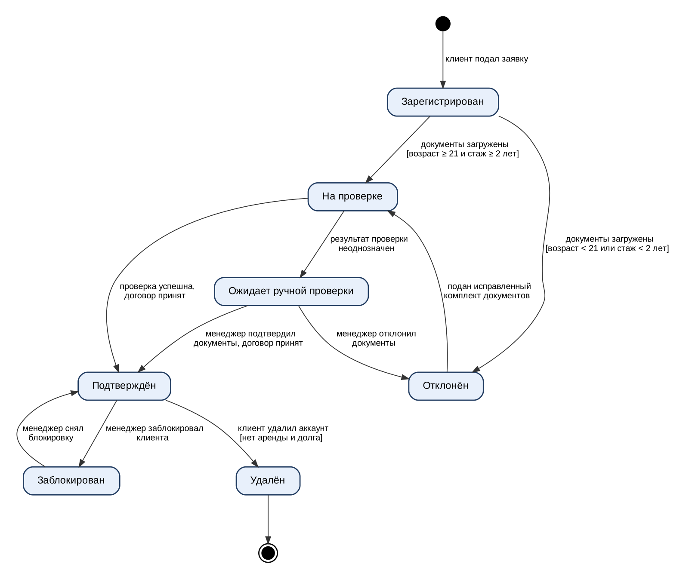
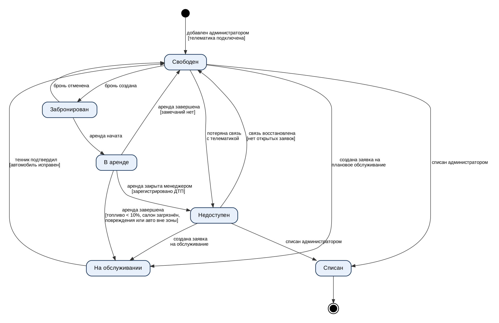
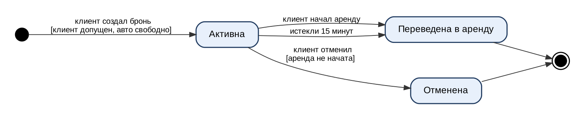
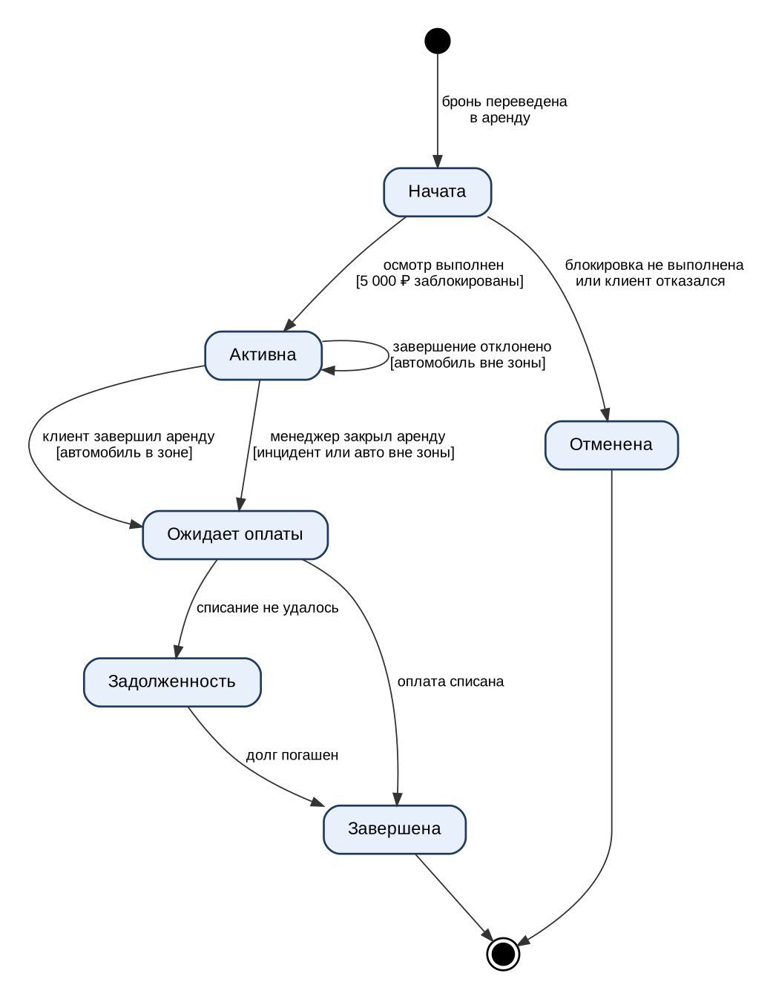
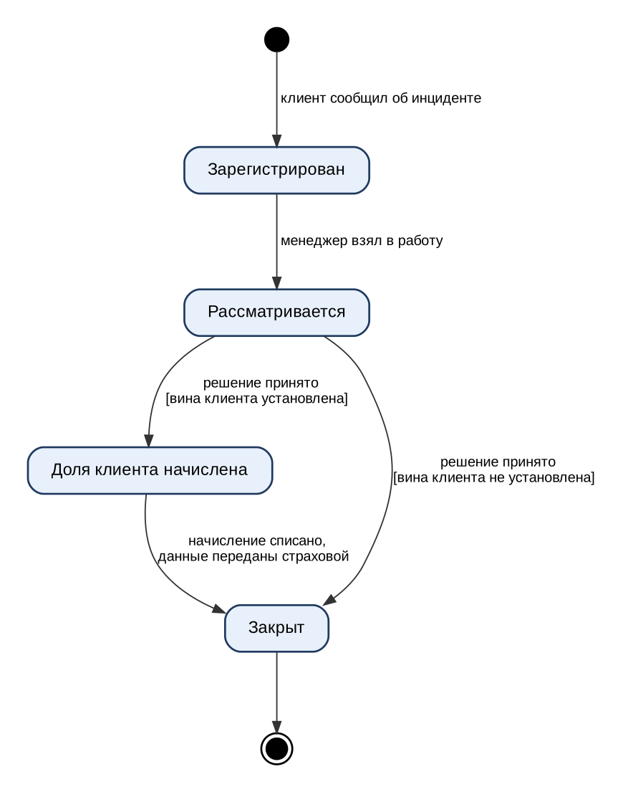

# Задание 7. Диаграммы состояний

Диаграммы состояний описывают жизненный цикл сущностей, у которых есть значимые статусы. Для проекта выбраны пять сущностей: **Клиент, Автомобиль, Бронь, Аренда, Инцидент**. Остальные сущности (Платёж, Начисление, Заявка на обслуживание, Обращение) имеют простой линейный цикл, диаграмма им не нужна (лекция 4: не каждой сущности нужна диаграмма состояний).

**Правила, которые мы проверяли (лекция 4):**
- одна диаграмма описывает одну сущность;
- у каждой диаграммы есть начальное и конечное состояние;
- одно и то же событие не ведёт в разные состояния без условия (условия записаны в квадратных скобках);
- в каждое состояние можно попасть (иначе оно лишнее или в требованиях дыра);
- прямоугольник это состояние, а стрелка это переход (действие), а не наоборот (отличие от диаграммы деятельности).

Состояния становятся значениями статуса в [диаграмме классов](../06-class-diagram/class-diagram.md), переходы становятся методами классов. Условия переходов ссылаются на [бизнес-правила](../04-domain/business-rules.md).

Файлы: у каждой диаграммы есть PNG и SVG, исходники Graphviz и генератор лежат в [src/](src/).

---

## 1. Клиент (Customer)



| Переход | Событие | Условие | Метод | Правило |
|---|---|---|---|---|
| Зарегистрирован → На проверке | Загружены документы | Возраст ≥ 21 и стаж ≥ 2 лет | `submitDocuments()` | БП-01 |
| Зарегистрирован → Отклонён | Загружены документы | Возраст < 21 или стаж < 2 лет | `submitDocuments()` | БП-01 |
| На проверке → Подтверждён | Проверка успешна, договор принят | | `confirm()` | БП-06 |
| На проверке → Ожидает ручной проверки | Результат проверки неоднозначен | | | БП-04 |
| Ожидает ручной проверки → Подтверждён | Менеджер подтвердил документы, договор принят | | `confirm()` | БП-04, БП-06 |
| Ожидает ручной проверки → Отклонён | Менеджер отклонил документы | Указана причина | `reject(reason)` | БП-04 |
| Отклонён → На проверке | Подан исправленный комплект документов | | `submitDocuments()` | |
| Подтверждён → Заблокирован | Менеджер заблокировал клиента | | `block()` | |
| Заблокирован → Подтверждён | Менеджер снял блокировку | | | |
| Подтверждён → Удалён | Клиент удалил аккаунт | Нет аренды и долга | | БП-34 |

Состояние «Подтверждён» не означает, что клиент может бронировать: нужны ещё привязанная карта и отсутствие долга (`canBook()`, БП-05, БП-07).

---

## 2. Автомобиль (Vehicle)



| Переход | Событие | Условие | Метод | Правило |
|---|---|---|---|---|
| (старт) → Свободен | Добавлен администратором | Телематика подключена | | |
| Свободен → Забронирован | Бронь создана | | `reserve()` | БП-11 |
| Забронирован → Свободен | Бронь отменена | | `release()` | |
| Забронирован → В аренде | Аренда начата | | | БП-12, БП-13 |
| В аренде → Свободен | Аренда завершена | Замечаний нет | | БП-32 |
| В аренде → На обслуживании | Аренда завершена | Топливо < 10%, салон загрязнён, повреждения или авто вне зоны | `sendToService()` | БП-32 |
| В аренде → Недоступен | Аренда закрыта менеджером | Зарегистрировано ДТП | | БП-29 |
| Недоступен → На обслуживании | Создана заявка на обслуживание | | `sendToService()` | |
| Свободен → На обслуживании | Создана заявка на плановое обслуживание | | `sendToService()` | БП-30 |
| Свободен → Недоступен | Потеряна связь с телематикой | | | |
| Недоступен → Свободен | Связь восстановлена | Нет открытых заявок | `markAvailable()` | БП-31 |
| На обслуживании → Свободен | Техник подтвердил выполнение | Автомобиль исправен | `markAvailable()` | БП-31 |
| Свободен, Недоступен → Списан | Списан администратором | Нет брони и аренды | `decommission()` | |

Событие «аренда завершена» имеет три взаимоисключающих условия (замечаний нет, есть замечания, зарегистрировано ДТП), поэтому неоднозначности нет.

---

## 3. Бронь (Booking)



| Переход | Событие | Условие | Метод | Правило |
|---|---|---|---|---|
| (старт) → Активна | Клиент создал бронь | Клиент допущен, автомобиль свободен | | БП-05, БП-09, БП-11 |
| Активна → Переведена в аренду | Клиент начал аренду | | `convertToRental()` | БП-08 |
| Активна → Переведена в аренду | Истекли 15 минут | | `convertToRental()` | БП-08 |
| Активна → Отменена | Клиент отменил бронь | Аренда не начата | `cancel()` | БП-08 |

Бронь не имеет состояния «Истекла»: по правилу БП-08 истечение 15 минут не отменяет бронь, а запускает аренду в режиме ожидания.

---

## 4. Аренда (Rental)



| Переход | Событие | Условие | Метод | Правило |
|---|---|---|---|---|
| (старт) → Начата | Бронь переведена в аренду | | | БП-08 |
| Начата → Активна | Осмотр выполнен | 5 000 ₽ заблокированы | `start()` | БП-12, БП-13 |
| Начата → Отменена | Блокировка не выполнена или клиент отказался | Автомобиль не открывался | | БП-13 |
| Активна → Активна | Завершение отклонено | Автомобиль вне зоны | `finish()` | БП-14 |
| Активна → Ожидает оплаты | Клиент завершил аренду | Автомобиль в зоне | `finish()` | БП-14 |
| Активна → Ожидает оплаты | Менеджер закрыл аренду | Инцидент или автомобиль вне зоны | `close()` | БП-14, БП-29 |
| Ожидает оплаты → Завершена | Оплата списана | | | БП-19 |
| Ожидает оплаты → Задолженность | Списание не удалось | | | БП-20 |
| Задолженность → Завершена | Долг погашен | | | БП-20 |

Петля «Активна → Активна» нужна, чтобы показать, что отклонённое завершение не меняет состояние аренды, но тарификация продолжается.

---

## 5. Инцидент (Incident)



| Переход | Событие | Условие | Метод | Правило |
|---|---|---|---|---|
| (старт) → Зарегистрирован | Клиент сообщил об инциденте | | | БП-26 |
| Зарегистрирован → Рассматривается | Менеджер взял в работу | | | |
| Рассматривается → Закрыт | Решение принято | Вина клиента не установлена | `close()` | |
| Рассматривается → Доля клиента начислена | Решение принято | Вина клиента установлена | `calculateClientShare()` | БП-27, БП-28 |
| Доля клиента начислена → Закрыт | Начисление списано, данные переданы страховой | | `close()` | БП-24 |

Сумма в состоянии «Доля клиента начислена» зависит от правил БП-27 (доля) или БП-28 (полный ущерб при исключении или отказе страховой).

---

## Как перерисовать

```bash
cd docs/07-state-diagrams/src
python3 gen_states.py   # нужен установленный Graphviz (команда dot)
```

Файлы появятся в папке `src/`, их нужно переместить на уровень выше. Состояния и переходы описаны списками в `gen_states.py`.
